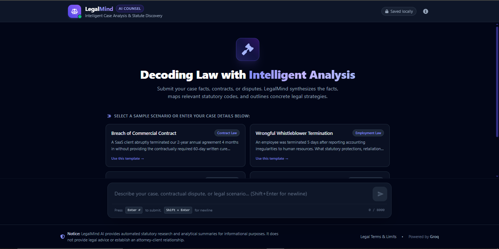
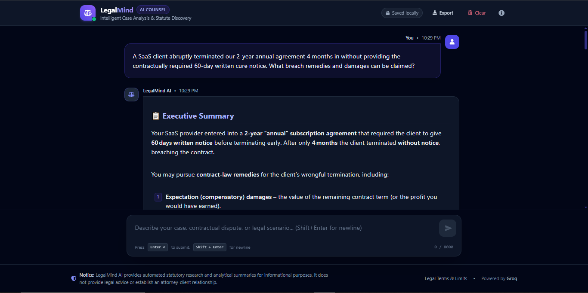
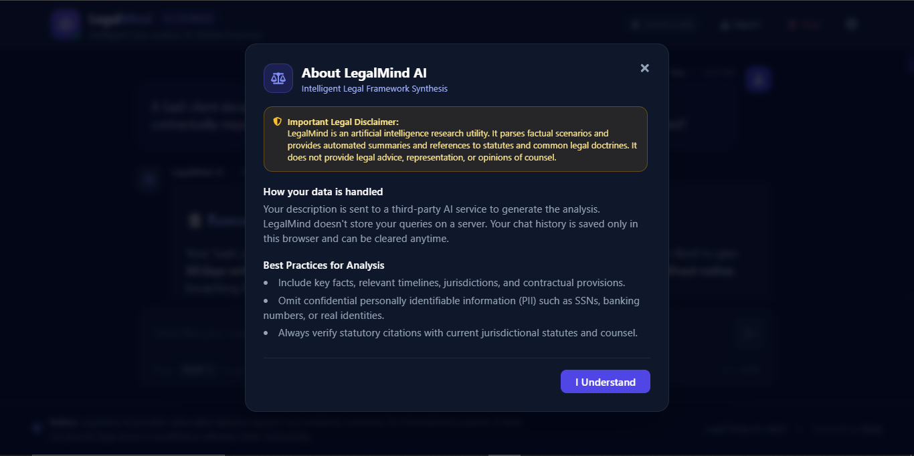
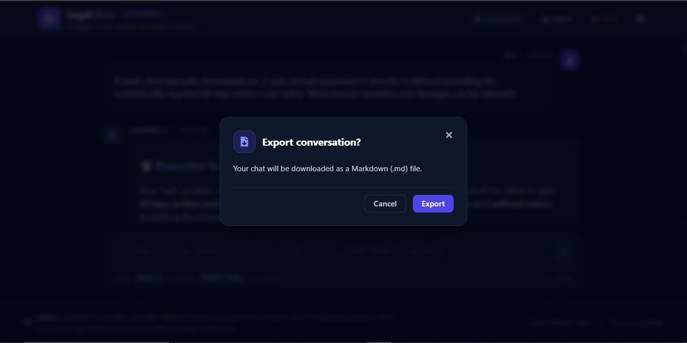
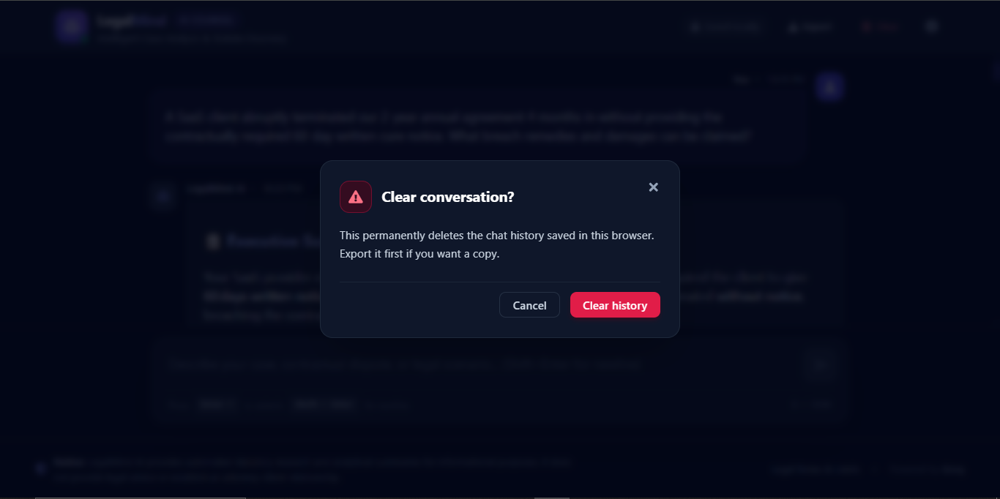

# Legal Mind — Intelligent Case Analysis & Statute Discovery

Legal Mind is an AI-powered legal analysis application that transforms complex legal scenarios into structured analytical summaries, relevant statutory references and actionable next steps. It helps users evaluate legal issues more efficiently through an interactive conversational interface powered by Groq AI inference.

## ⚖️ The Problem

Understanding complex legal disputes, contract breaches and statutory codes can be time-consuming, expensive and challenging for individuals and businesses, especially those without legal expertise.

Users often struggle to identify applicable statutory provisions, assess potential liabilities and determine appropriate next steps. Manually reviewing legal information can delay initial assessments and make it difficult to organize case facts into a clear, actionable format.

## 💡 The Solution

Legal Mind provides AI-powered legal analysis that transforms user-submitted case details into structured, easy-to-understand summaries.

By leveraging advanced AI inference through Groq, the application analyzes legal scenarios, identifies key issues, maps them to relevant statutory frameworks and presents strategic action items within seconds.

The result is a streamlined initial analysis experience that helps users better understand legal scenarios and organize potential next steps. Legal Mind is intended for educational and informational purposes and does not replace professional legal advice.

## 📖 Overview

Legal Mind combines an interactive chat interface with an Express.js backend and Groq-powered AI inference to deliver structured legal analysis.

### How It Works

1. **Submit Case Details:** Users describe their legal scenario or select a pre-configured legal template.
2. **Process the Inquiry:** The frontend securely transmits the inquiry and conversational context to the Express.js backend.
3. **Generate AI Analysis:** The backend routes the request to AI providers through the Groq SDK.
4. **Structure the Results:** The AI synthesizes the case facts into an executive summary, statutory citations and strategic action items.
5. **Display the Analysis:** The application parses the generated response and renders it using formatted Markdown, tables and organized sections.
6. **Save or Export:** Users can revisit saved conversations, copy individual analyses or export the complete consultation transcript as a Markdown document.

## ✨ Features

- **Interactive Chat Interface:** Supports conversational legal inquiries and AI-generated responses with timestamps and automatic scrolling.
- **Persistent Conversation History:** Stores chat sessions in local browser storage so users can revisit previous conversations after page reloads.
- **Pre-Built Legal Templates:** Provides quick-start scenarios for contract breaches, whistleblower termination, security deposit disputes and intellectual property or NDA violations.
- **AI-Powered Legal Analysis:** Generates executive summaries, statutory references and strategic action items based on submitted case details.
- **Safe Markdown and Table Rendering:** Converts AI responses into structured sections, tables and bulleted lists using a custom XSS-safe renderer.
- **One-Click Copy and Export:** Copies individual legal analyses and exports complete consultation transcripts as formatted Markdown files.
- **Independent Chat Scrolling:** Maintains a fixed header, input area and footer while allowing the conversation thread to scroll independently.
- **Security Hardening:** Implements JSON payload limits, IP-based sliding-window rate limiting, input length validation and HTTP security headers.
- **Legal Disclaimers and Compliance Notices:** Includes prominent legal disclaimer banners, accessible custom modals and clear notices explaining the application's educational and informational scope.
- **Flexible Deployment:** Supports local development and production deployment through Vercel serverless functions and static site hosting.

## 🧩 Technology Stack

### Frontend
- React.js 18.3
- Tailwind CSS 3.4
- DaisyUI 4.12
- React Icons
- React Hook Form
- Custom XSS-safe Markdown and Table Renderer

### Backend
- Node.js
- Express.js 4.19
- Groq SDK 0.5 for AI inference
- Dotenv for environment configuration
- CORS
- HTTP Security Headers
- In-Memory Rate Limiting

### Infrastructure and Deployment
- Vercel for serverless functions and static site hosting
- Browser Local Storage for conversation persistence

## 📄 License

Private — All rights reserved.
